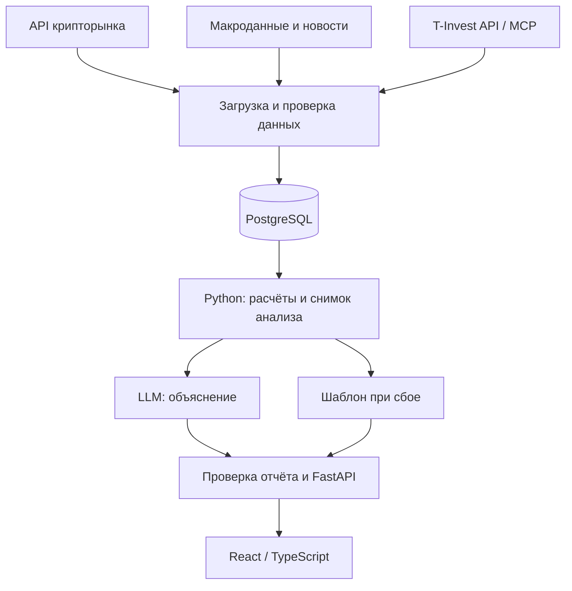

# Crypto Cycle Intelligence

**AI-аналитика Bitcoin, Ethereum и связанных биржевых инструментов: рыночная ситуация, исторические аналоги и аргументы для торгового решения.**

Проект для программы **«Инвест. Премаркет»** от Т-Банка.

> **Статус: проектирование MVP.** Ниже описаны планируемое решение и критерии его проверки. Интеграции, качество сигналов и польза AI-объяснений ещё предстоит подтвердить экспериментами.

## Идея

Crypto Cycle Intelligence — аналитическая веб-платформа для частных инвесторов и трейдеров, которые работают с BTC и ETH и хотят опираться на понятную аналитику в своей торговле.

Сервис объединит цены, объёмы, технические показатели, макроэкономические факторы и новости. На их основе он покажет состояние рынка, найдёт похожие исторические периоды и сформирует объяснение: что поддерживает рассматриваемый сценарий, что ему противоречит и какие изменения потребуют пересмотреть гипотезу.

Основной горизонт MVP — **1–14 дней**. Предусмотрены графики **1h / 4h / 1d** и анализ как самих криптовалют, так и связанных инструментов, доступность которых будет подтверждена через T-Invest API/MCP.

## Проблема и аудитория

Трейдеру приходится вручную сопоставлять графики, макроданные, новости и аналитические обзоры. Сигналы могут противоречить друг другу, а проверка их актуальности требует времени.

На Мосбирже уже появились инструменты, связанные с криптовалютами, включая фьючерсы на индексы Bitcoin и Ethereum. Работа с такими контрактами требует учитывать не только ситуацию на крипторынке, но и валюту расчётов, экспирацию и спецификацию инструмента. Указанные криптофьючерсы доступны квалифицированным инвесторам. [Источник: Московская биржа](https://www.moex.com/n99897?nt=0).

**Рабочая гипотеза команды:** специализированный сервис поможет сократить время анализа и лучше понимать риски. Предположение о недостатке удобной аналитики для этой аудитории проверим интервью и обзором существующих решений.

Целевая аудитория:

- частные трейдеры Bitcoin и Ethereum;
- квалифицированные инвесторы, использующие связанные биржевые инструменты;
- инвесторы, которым важно понимать основания и ограничения аналитического вывода.

## Что получит пользователь

| Результат | Польза |
|---|---|
| Единый обзор BTC/ETH | Цены, объёмы, индикаторы, макрофакторы и новости в одном месте |
| Раздельная оценка макросреды и тренда | Видны противоречия между факторами |
| Исторические аналоги | Можно изучить исходы похожих эпизодов и размер выборки |
| Аргументы за и против сценария | Легче проверить собственную гипотезу |
| Источники и время обновления | Можно проверить актуальность и происхождение фактов |
| Сведения о доступных контрактах | Можно учесть особенности биржевого инструмента |

Ожидаемый эффект — **меньше времени на сбор информации и лучшее понимание принимаемого риска**. Это гипотеза для проверки, а не полученный результат.

## Основной сценарий

1. Трейдер выбирает BTC или ETH и горизонт анализа.
2. Система загружает доступные рыночные данные, макропоказатели и новости, проверяет их качество и свежесть.
3. Расчётный модуль определяет индикаторы, уровни, состояние рынка и исторические аналоги.
4. AI формирует объяснение по подготовленным фактам: аргументы за и против, риски и условия пересмотра сценария.
5. Пользователь изучает дашборд и опирается на полученную аналитику в своей торговле: открывает позицию, откладывает сделку или продолжает наблюдение.

Для связанного фьючерса дополнительно показываются доступные параметры контракта. Решение о сделке и её исполнение остаются за пользователем.

## Возможности MVP

Все перечисленные функции входят в план разработки.

| Блок | Планируемое содержание |
|---|---|
| Рыночные данные | Текущие цены и исторические свечи BTC/ETH, объёмы, таймфреймы 1h / 4h / 1d |
| Технический анализ | EMA20/50/200, RSI14, ATR14, MACD, волатильность, базовые уровни поддержки и сопротивления |
| Макросреда | 3–4 доступных ряда: доллар или его прокси, ставки/доходности США, Nasdaq, показатель ликвидности |
| Новости | Сводка по проверяемым источникам с датой публикации и ссылками |
| Рыночный режим | Прозрачные правила оценки макросреды и технического тренда |
| Исторические аналоги | Поиск похожих состояний; последующие доходности и просадки на горизонтах 1/3/7/14/30 дней |
| AI-отчёт | Краткий вывод, аргументы за и против, ограничения данных, условия пересмотра сценария |
| T-Invest | Поиск и сведения о реально доступных связанных инструментах; котировки при поддержке API |
| Надёжность | Кеширование, контроль свежести, статусы отсутствующих данных, шаблонный отчёт при сбое LLM |

Отчёт будет показывать число независимых исторических эпизодов и распределение их результатов. Частота положительных исходов в небольшой выборке не будет обозначаться как вероятность будущей прибыли.

Торговые поручения, произвольная генерация стратегий и сложная предиктивная модель находятся за пределами первого MVP.

## Роль AI

**Код рассчитывает показатели. AI объясняет их сочетание.**

Расчётному модулю поручаются:

- индикаторы, доходности, волатильность и просадки;
- классификация рыночного режима по заданным правилам;
- поиск исторических аналогов;
- формирование проверяемого снимка анализа.

LLM получает структурированный `AnalysisSnapshot`: готовые показатели, факторы, ограничения и сведения о новостях с источниками. Модель формулирует связное объяснение и выделяет противоречия.

Для фиксированного отчёта можно использовать шаблон. Предполагаемое преимущество AI — более гибкое объяснение разных сочетаний факторов. Его проверим отдельным сравнением с шаблонной версией.

**Предварительный выбор модели:** готовая LLM через API, без обучения с нуля. Конкретного провайдера выберем после сравнения точности, задержки и стоимости отчёта.

### Контроль достоверности

- Числа и уровни поступают из расчётного слоя.
- У фактов сохраняются источники и временные метки.
- Ответ проверяется на соответствие снимку анализа.
- Недостаток данных и противоречия показываются явно.
- Новости используются как контекст; связь события с движением цены требует отдельного обоснования.
- При ошибке модели или недоступности API возвращается шаблонный отчёт.

## Архитектура

Предполагается единое backend-приложение с отдельными модулями загрузки, расчётов и отчётов.

| Компонент | Ответственность | Предварительный стек |
|---|---|---|
| Адаптеры источников | Загрузка, нормализация и контроль свежести | Python, HTTP API / RSS |
| Хранилище | История, источники, временные метки, расчёты и отчёты | PostgreSQL |
| Аналитическое ядро | Индикаторы, уровни, режимы, аналоги и сигналы для эксперимента | pandas, NumPy |
| Генератор отчётов | LLM, проверка фактов, шаблонный резерв | API выбранной модели |
| Backend | Выдача анализа и статусов источников | FastAPI, Pydantic |
| Интерфейс | Графики, показатели, источники и объяснения | React, TypeScript |

Пересчёт выполняется по расписанию и после поступления новых данных. Снимки анализа сохраняются, чтобы можно было воспроизвести отчёт на выбранную дату.

## Данные и источники

Конкретные поставщики, покрытие истории и условия использования проверяются до основной разработки.

| Данные | Возможные источники | Формат | План обновления |
|---|---|---|---|
| Цены, свечи и объёмы BTC/ETH | API криптобиржи или провайдера рыночных данных | JSON / CSV | Цены каждые 1–5 минут; индикаторы после закрытия свечи |
| Параметры и котировки контрактов | T-Invest API/MCP | JSON / Protobuf | Котировки в часы торгов; справочники ежедневно |
| Макроэкономические ряды | FRED/ALFRED и другие разрешённые источники | JSON / CSV | После публикации новых значений |
| Новости | RSS/API финансовых и криптоизданий, публикации регуляторов и криптопроектов | Текст, заголовок, ссылка, источник, время | Каждые 5–15 минут |

Для наблюдений сохраняются время события, время публикации при наличии, время загрузки, источник, валюта и единицы измерения.

Основные ограничения данных: квоты API, платный доступ, неполная история, задержки, пересмотры макропоказателей, дубли и неподтверждённые новости. Для исторических проверок используются только сведения, доступные на момент решения. Если это невозможно подтвердить, соответствующий источник исключается из строгого бэктеста.

## Интеграция с Т-Инвестициями

Интеграция должна связать глобальную аналитику BTC/ETH с реально доступными через брокера инструментами.

Перед реализацией проверим:

1. Какие методы и инструменты доступны через API/MCP.
2. Можно ли получить необходимые параметры и котировки.
3. Какой токен и уровень доступа нужны.
4. Какие ограничения действуют на использование и отображение данных.

В MVP предполагается доступ для чтения. Сопоставление криптовалюты с контрактом выполняется по подтверждённым параметрам. Учитываются базовый актив, валюта, экспирация и особенности расчётов.

Спотовые BTC/ETH и связанные фьючерсы анализируются раздельно: результаты торговли одним инструментом нельзя переносить на другой без проверки. При отсутствии нужного инструмента сервис покажет ограничение.

## Как проверим решение

### 1. Бэктест торговых сигналов

**Гипотеза:** сигналы расчётного ядра дают лучший результат с учётом риска, чем простая стратегия EMA20/50.

| Параметр | План эксперимента |
|---|---|
| Рынок | BTC и ETH; первый тест — криптовалюты, фьючерсы проверяются отдельно |
| Данные | Цель — три года часовой истории; последний год оставить для независимой проверки |
| Торговля | Внутридневные сделки по заранее зафиксированным сигналам |
| База сравнения | EMA20/50 при одинаковых правилах учёта риска и издержек |
| Издержки | Комиссии и проскальзывание |
| Основная метрика | Годовой коэффициент Шарпа после издержек |
| Первый порог | Шарп ≥ 1 и минимум на 0,2 выше базовой стратегии |

До проверки зафиксируем условия входа и выхода, размер позиции, параметры базовой стратегии и способ годового пересчёта метрики. Исполнение моделируется не раньше следующей свечи после формирования сигнала.

Конкретные правила преобразования рыночной оценки в торговый сигнал ещё предстоит определить. Параметры не подбираются на отложенном периоде. Недостаточная история или малое число сделок означают, что выводов для продолжения пока недостаточно.

Указанный порог — критерий перехода к следующему этапу проверки. Результатов бэктеста пока нет.

### 2. Проверка AI-объяснений

На одинаковых снимках данных сравним AI-отчёт и шаблонное объяснение:

- соответствие фактам, числам и источникам;
- понятность выводов;
- время, необходимое пользователю для анализа;
- стоимость и задержку генерации.

Цель на контрольном наборе — **ноль неподтверждённых фактических утверждений**. Пользу объяснений оцениваем отдельно: успешный бэктест проверяет сигналы, но не подтверждает эффективность LLM.

### 3. Проверка востребованности

Проведём первые 10 интервью с целевыми пользователями и тест макета. Проверим, какие задачи уже закрывают существующие сервисы, нужен ли единый отчёт и за какую пользу пользователи готовы платить.

## Основные риски

| Риск | Почему критичен | Как проверить до основной разработки |
|---|---|---|
| Недостаточный спрос | Пользователь не получает дополнительной пользы | Интервью, тест макета, обзор альтернатив |
| Недоступные данные и интеграции | Анализ становится неполным или невоспроизводимым | Пробные API-запросы, проверка истории и прав на данные |
| Слабые сигналы | Преимущество исчезает после издержек | Бэктест на отложенном периоде |
| Ошибки AI | Теряется доверие к отчёту | Контрольные примеры и сравнение с шаблоном |
| Высокая стоимость | Данные и LLM обходятся дороже готовности платить | Расчёт стоимости отчёта и тест цены |

## План разработки

- [ ] Проверить источники, права на данные и доступность инструментов T-Invest.
- [ ] Собрать загрузку и хранилище с контролем качества.
- [ ] Реализовать индикаторы, уровни, режимы и исторические аналоги.
- [ ] Собрать дашборд BTC/ETH и отображение новостей.
- [ ] Добавить LLM-отчёт, проверку фактов и шаблонный резерв.
- [ ] Провести бэктест, оценку AI-объяснений и пользовательские тесты.
- [ ] Подготовить воспроизводимую демонстрацию и инструкцию запуска.

После проверки основной версии можно рассмотреть funding rate, open interest, ETF-потоки, сравнение BTC/ETH и уведомления о существенных изменениях.

## Критерий готовности MVP

Пользователь получает воспроизводимый анализ BTC и ETH: графики, состояние рынка, изменения факторов, новости, исторические аналоги и объяснение с источниками. Подключённые брокерские инструменты подтверждены реальными запросами. Пропуски и устаревшие данные явно обозначены.

Исходный код приложения, инструкция запуска и результаты проверок будут добавлены по мере реализации.

## Официальные материалы

- [T-Invest API: начало работы](https://developer.tbank.ru/invest/intro/intro/)
- [T-Invest MCP](https://developer.tbank.ru/invest/mcp)
- [T-Invest API: ограничения использования и FAQ](https://developer.tbank.ru/invest/intro/faq)
- [Мосбиржа: инструменты на индексы цифровых валют](https://www.moex.com/n99897?nt=0)

---

Торговое решение и его исполнение остаются за пользователем. Сервис предназначен для аналитической поддержки; результаты исторических проверок не гарантируют будущую доходность.
